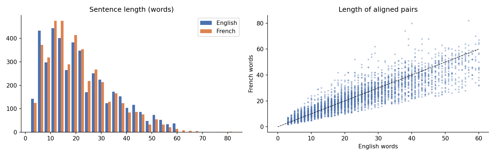
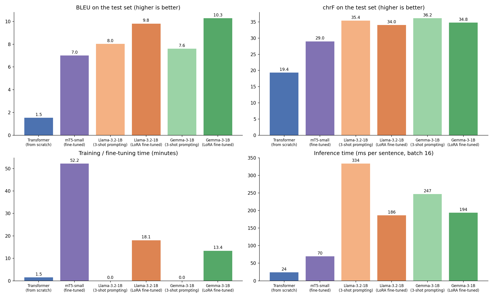
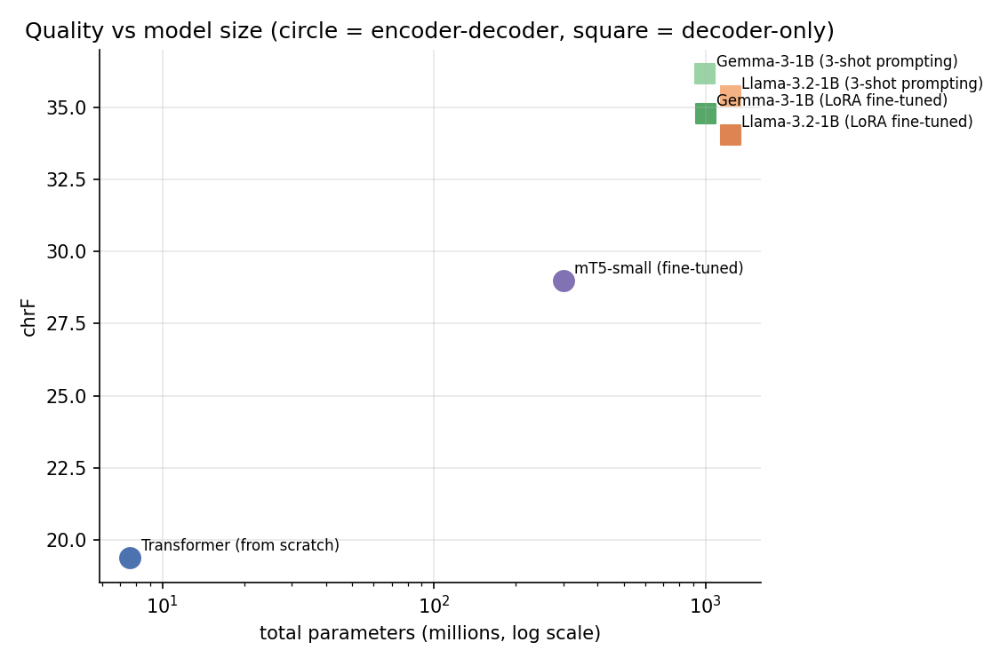
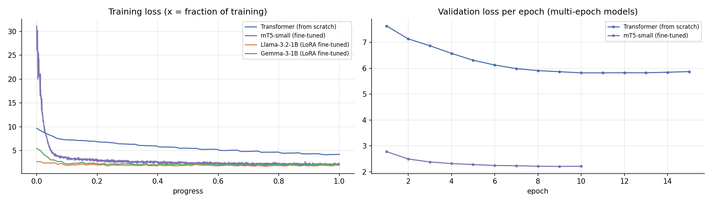
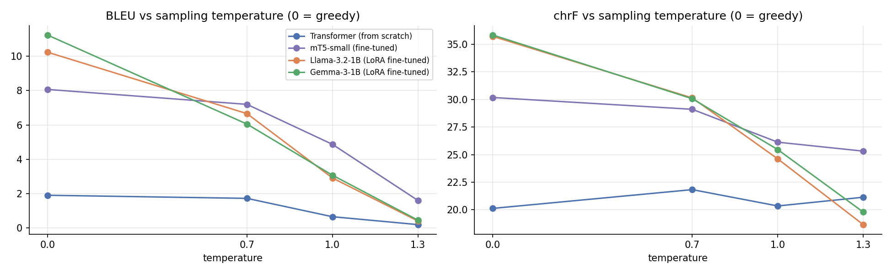

# English to French Machine Translation on *Pride and Prejudice*: Transformer, mT5, LLaMA and Gemma

**Course:** Foundations of Generative AI (ICT4403), Assignment 3
**Author:** Riddhima Jain (230953108)

## 1. Problem statement and objective
The goal is to translate English sentences from Jane Austen's *Pride and Prejudice* into French and to compare two families of neural translation models:

- **Encoder–decoder models:** a basic Transformer trained from scratch, and mT5 fine-tuned on our data.
- **Decoder-only models:** LLaMA and Gemma, used with few-shot prompting and with LoRA fine-tuning.

All systems are compared on the same test sentences using BLEU, chrF, training time, inference time and parameter count. Their translations are then examined for responsible-AI problems: gender bias, hallucination, cultural misrepresentation and the handling of sensitive content.

## 2. Dataset
| | |
|---|---|
| **Name** | *Pride and Prejudice* (Jane Austen), English–French sentence-aligned edition, from the OPUS Books corpus |
| **Source link** | https://huggingface.co/datasets/Helsinki-NLP/opus_books (config `en-fr`) |
| **Original corpus** | OPUS Books, https://opus.nlpl.eu/Books/corpus/version/Books (Tiedemann, 2012) |
| **Licence** | Public-domain literary texts; see the OPUS Books page for details |

The `en-fr` part of OPUS Books contains several novels stored one after another. The notebook extracts *Pride and Prejudice* by locating its first sentence ("It is a truth universally acknowledged…") and its last sentence ("…had been the means of uniting them."). The extracted pairs are saved to `data/pride_prejudice_en_fr.csv`.

| Statistic | Value |
|---|---|
| Aligned sentence pairs found for the novel | 4,903 |
| Pairs after cleaning | 4,358 |
| Train / validation / test | 3,488 / 435 / 435 |
| Mean sentence length (English / French words) | 21.8 / 20.9 |
| Total words (English / French) | 95,104 / 91,209 |
| Distinct words (English / French) | 5,702 / 7,833 |



**Data quality caveats found during evaluation:**
- **Missing characters in the French text.** The French side of this OPUS edition has lost several characters: `à` appears as `a`, `è` and `ê` as `e`, and `œ` as `o` (so *sœur* is written *sour* and *très* is written *tres*), while `é` is kept. None of the 435 test references contains `à` or `è`. This matters for the scores, because a model that writes correct French is penalised (see section 6).
- **Loose alignment.** The French translation is old and fairly free, and some pairs are only loosely aligned. For example, "This is my advice." is paired with "Collins, il faut vous marier." (*Collins, you must get married.*).
- **Low absolute scores.** Every system is scored against a single, freely translated reference, so absolute BLEU scores are low for all of them.

**Preprocessing:** Unicode normalisation; removal of empty lines, chapter headings and duplicate pairs; English sentences limited to 3–60 words; French/English length ratio between 0.5 and 2.5 to drop misaligned pairs; a seeded random split into train, validation and test (80 / 10 / 10, with validation and test capped at 500 sentences each). The split files are in `data/train.csv`, `data/val.csv` and `data/test.csv`.

## 3. Models
| Model | Architecture | Checkpoint | Adaptation |
|---|---|---|---|
| Basic Transformer | encoder–decoder | none (random init) | trained from scratch: 3 + 3 layers, width 256, 4 heads, shared 8k BPE vocabulary |
| mT5 | encoder–decoder | `google/mt5-small` | full fine-tuning with the prefix `translate English to French:` |
| LLaMA | decoder-only | `meta-llama/Llama-3.2-1B-Instruct` | (a) 3-shot prompting, (b) LoRA fine-tuning (rank 16, attention projections) |
| Gemma | decoder-only | `google/gemma-3-1b-it` | (a) 3-shot prompting, (b) LoRA fine-tuning (rank 16, attention projections) |

**Comparable settings:**
- the same train / validation / test split
- greedy decoding
- a maximum of 128 new tokens
- inference batch size 16
- the same GPU
- the same prompt, examples and LoRA settings for LLaMA and Gemma

## 4. Execution steps and dependencies
**Dependencies:** Python 3.10+, `torch`, `transformers>=4.50`, `peft`, `datasets`, `tokenizers`, `sentencepiece`, `sacrebleu`, `accelerate`, `pandas`, `matplotlib` (see `requirements.txt`).

**Google Colab (recommended, T4 GPU):**
1. Open `Pride_and_Prejudice_EN_FR_Translation.ipynb` in Colab and choose *Runtime → Change runtime type → T4 GPU*.
2. Both LLMs are gated. On Hugging Face, request access to [Llama-3.2-1B-Instruct](https://huggingface.co/meta-llama/Llama-3.2-1B-Instruct) (Meta approves it, usually within a few hours) and accept the licence of [gemma-3-1b-it](https://huggingface.co/google/gemma-3-1b-it) (instant). If Llama access is still pending, set `LLAMA_ID = "unsloth/Llama-3.2-1B-Instruct"` in the configuration cell, an ungated copy of the same weights.
3. Create a read token at https://huggingface.co/settings/tokens and add it in Colab's *Secrets* panel under the name `HF_token` (the name the notebook reads), with notebook access switched on.
4. *Runtime → Run all.* The full run takes roughly 1 to 1.5 hours on a T4. Each finished model is saved in `results/systems/`, so a re-run after a disconnect skips finished models.

**Local:** `pip install -r requirements.txt`, set the `HF_TOKEN` environment variable, then run the notebook. A CUDA GPU is strongly recommended.

**Changes made while running on the free Colab T4:**
- mT5 ran out of GPU memory at batch size 16. It was trained with micro-batches of 2 and 8 gradient-accumulation steps, which keeps the effective batch at 16, plus gradient checkpointing. This makes mT5 training slower (52 minutes) but keeps the optimisation equivalent to batch size 16.
- Colab's preinstalled `torchao` package is outdated and caused errors when loading the LLMs, so the Llama cell uninstalls it first. These models do not use it.

## 5. Repository structure
```
├── Pride_and_Prejudice_EN_FR_Translation.ipynb   # full implementation, executed on Colab with outputs
├── data/                       # pride_prejudice_en_fr.csv (4,903 extracted pairs) and train/val/test.csv
├── analysis/accent_normalised_eval.py   # accent-insensitive re-scoring (see section 6)
├── results/
│   ├── metrics.csv             # BLEU, chrF, parameters, training and inference time per system
│   ├── accent_normalised_scores.csv  # BLEU/chrF with accents removed from both sides
│   ├── temperature.csv         # BLEU/chrF at different sampling temperatures
│   ├── tokenisation.csv        # tokens per sentence for each tokeniser
│   ├── test_translations.csv   # every test sentence translated by every system
│   ├── translation_samples.md  # readable samples
│   ├── responsible_checks.csv  # hallucination / omission / untranslated / name checks
│   ├── probes.csv, gender_probe_summary.csv, flagged_translations.csv
│   ├── systems/*.json          # raw per-system results
│   └── plots/                  # metric comparison, size vs quality, training curves, temperature
├── requirements.txt
└── README.md
```

## 6. Results
All numbers come from one run of the notebook on a Google Colab **Tesla T4** GPU (float32, PyTorch 2.11, transformers 5.20). The test set has 435 sentences and every system uses greedy decoding.

| System | Architecture | Adaptation | Parameters | Trained parameters | Training time | Inference (total / per sentence) | BLEU | chrF |
|---|---|---|---|---|---|---|---|---|
| Transformer | encoder–decoder | trained from scratch | 7.6 M | 7.6 M (100%) | 1.5 min | 10.3 s / 24 ms | 1.53 | 19.37 |
| mT5-small | encoder–decoder | full fine-tuning | 300.2 M | 300.2 M (100%) | 52.2 min | 30.4 s / 70 ms | 7.00 | 28.99 |
| Llama-3.2-1B | decoder-only | 3-shot prompting | 1,235.8 M | none | none | 145.1 s / 334 ms | 8.03 | 35.39 |
| Llama-3.2-1B | decoder-only | LoRA fine-tuning | 1,239.2 M | 3.41 M (0.28%) | 18.1 min | 81.0 s / 186 ms | 9.81 | 34.05 |
| Gemma-3-1B | decoder-only | 3-shot prompting | 999.9 M | none | none | 107.5 s / 247 ms | 7.61 | **36.16** |
| Gemma-3-1B | decoder-only | LoRA fine-tuning | 1,002.9 M | 2.98 M (0.30%) | 13.4 min | 84.2 s / 194 ms | **10.29** | 34.79 |




**Accent-insensitive scores.** Because the references have lost some accented letters (section 2), `analysis/accent_normalised_eval.py` removes diacritics from both the outputs and the references and re-scores them.

| System | BLEU | BLEU, accent-insensitive | chrF | chrF, accent-insensitive |
|---|---|---|---|---|
| Transformer | 1.53 | 1.53 | 19.37 | 19.95 |
| mT5-small | 7.00 | 7.00 | 28.99 | 29.56 |
| Llama-3.2-1B, 3-shot | 8.03 | 9.25 | 35.39 | 36.95 |
| Llama-3.2-1B, LoRA | 9.81 | 10.12 | 34.05 | 34.82 |
| Gemma-3-1B, 3-shot | 7.61 | 10.00 | 36.16 | **38.73** |
| Gemma-3-1B, LoRA | 10.29 | **10.54** | 34.79 | 35.64 |

The prompted LLMs gain the most from this correction (Gemma 3-shot goes from 7.61 to 10.00 BLEU), because they are the only systems that write accented letters correctly: about 40% of their outputs contain `à` and about 31% contain `è`. The ranking at the top stays the same.

**Training.** The Transformer's validation loss stopped improving after epoch 10 (5.82) while its training loss kept falling, so early stopping ended training at epoch 15. That points to overfitting on 3,488 pairs. mT5 improved steadily and reached its best validation loss (2.21) at epoch 9 of 10. The LoRA models were trained for one epoch and ended with validation losses of 1.85 (Llama) and 2.05 (Gemma).



**Tokenisation** (mean tokens per test sentence; the sentences average 21.7 English and 20.9 French words):

| Tokeniser | Vocabulary | English tokens | French tokens |
|---|---|---|---|
| Our BPE (Transformer) | 8,000 | 26.5 | 26.6 |
| mT5 SentencePiece | 250,100 | 33.5 | 38.9 |
| Llama 3 BPE | 128,256 | 27.0 | 34.0 |
| Gemma 3 SentencePiece | 262,145 | 26.6 | 31.1 |

Translation samples for the first 25 test sentences are in `results/translation_samples.md`, and every output is in `results/test_translations.csv`.

## 7. Model comparison and evaluation
**Pretraining matters more than architecture.** The Transformer has the same encoder–decoder design as mT5 but no pretraining, and it reaches only 1.53 BLEU. Its output is fluent-looking French built from the novel's most common phrases, with little link to the source. "Jane then took it from her pocket-book, and gave it to Elizabeth" becomes "Jane se mit a sa mere et sa mere de son frere et sa mere". 54.7% of its outputs contain a repeated 4-word loop. A few thousand sentence pairs are not enough to learn a language from nothing. mT5 starts from a multilingual model and gets 7.00 BLEU from the same data. However, it was never trained on translation, and it still swaps in the novel's own vocabulary: "The doctor" became "Le colonel", and "The nurse" became "La jeune fille".

**Encoder–decoder vs decoder-only.**
- **Quality:** the two decoder-only LLMs are clearly the most accurate, with 34–36 chrF against 29 for mT5. Both are instruction-tuned 1B models, so they reach that level with three examples and no training.
- **Size:** they are also 3–4 times larger than mT5 and about 130–160 times larger than our Transformer, so the comparison is not only about architecture. Size alone does not decide the ranking either: Gemma (1.0 B) scores slightly better than Llama (1.24 B).
- **Speed:** the encoder–decoder models are much faster at inference, at 24 and 70 ms per sentence against 186–334 ms for the LLMs. A decoder-only model has to process the whole chat prompt (instruction, any examples and Llama's system header) before it writes a word, and it runs a 1B-parameter network for every output token. Few-shot prompting is the slowest, because each request carries three extra example translations.

**Adaptation method.** LoRA trains only about 0.3% of each LLM's parameters, yet fine-tuning a 1B model with LoRA took 13–18 minutes, much less than the 52 minutes needed to fully fine-tune the 300M-parameter mT5. LoRA raised BLEU for both LLMs (Llama 8.03 → 9.81, Gemma 7.61 → 10.29) but lowered chrF (35.39 → 34.05 and 36.16 → 34.79). The outputs show why. After fine-tuning, the models copy the reference corpus's conventions:
- "Mrs." instead of "Mme"
- unaccented `a` instead of `à` (in 0.5–1.4% of outputs instead of about 40%)
- the shorter, freer phrasing of the old translation

This earns exact word matches, which BLEU rewards. But the fine-tuned models also leave out more content (omission rose from 0.9% to 2.1–2.5% of sentences) and sometimes paraphrase too loosely, which costs them on chrF. With accents ignored, the BLEU gain from LoRA shrinks to 0.5–0.9 points, while the chrF advantage of prompting grows to about 2–3 points. So part of what LoRA learned was the dataset's formatting rather than better translation.

**Tokenisation.** Our 8k BPE, trained only on this novel, is the most compact (26.6 tokens per French sentence), but it cannot represent anything outside the book. The pretrained tokenisers need more tokens for French than for English: Gemma about 17% more, Llama 26% more, mT5 16% more. Their vocabularies are dominated by English (Llama) or shared by over 100 languages (mT5). More tokens mean more decoding steps, which adds to the decoder-only models' inference time.

## 8. Sampling-temperature analysis
The four trained systems translated the first 100 test sentences at four temperatures (0 = greedy). Sampling uses the plain temperature-scaled distribution, with no top-k or top-p.

| System | BLEU T=0 | 0.7 | 1.0 | 1.3 | chrF T=0 | 0.7 | 1.0 | 1.3 |
|---|---|---|---|---|---|---|---|---|
| Transformer | 1.90 | 1.72 | 0.65 | 0.19 | 20.13 | 21.83 | 20.35 | 21.14 |
| mT5-small | 8.07 | 7.20 | 4.87 | 1.60 | 30.18 | 29.11 | 26.13 | 25.32 |
| Llama-3.2-1B, LoRA | 10.24 | 6.66 | 2.91 | 0.40 | 35.72 | 30.14 | 24.62 | 18.66 |
| Gemma-3-1B, LoRA | 11.24 | 6.05 | 3.07 | 0.45 | 35.84 | 30.07 | 25.46 | 19.80 |



Example, "This is my advice.":

| T | Gemma-3-1B (LoRA) | mT5-small |
|---|---|---|
| 0 | C'est mon conseil. | Cette aide m'a fait a vous adresser ma conseil. |
| 0.7 | C'est mon conseil. | Désoler cette conseille. |
| 1.0 | đônez vers nopz ! | En effet elle nous assure tout cette précité. |
| 1.3 | Brit зімнантиц EGGG Nancy Knowles propose profiter dela mrrhtt cher couzingen … राखी … | On me dira tres chere opinion... |

- **Greedy decoding is best for translation.** For every model except the Transformer, BLEU and chrF fall steadily as temperature rises. Translation has one intended meaning, so the extra variety that sampling adds mostly becomes error.
- **The LLMs degrade fastest.** Gemma's BLEU drops from 11.24 to 0.45 and Llama's from 10.24 to 0.40. Their vocabularies of 128k–262k tokens cover many languages, scripts and code, so a flattened distribution gives real probability to tokens that have nothing to do with French. At T = 1.3 Gemma mixed Cyrillic, Devanagari and invented words, and Llama produced code fragments such as `getSelection`.
- **mT5 degrades most gently**, and at T ≥ 1.0 it has the highest BLEU of all four (4.87 and 1.60). Fine-tuning made its distribution narrow and centred on the novel's vocabulary, so even when sampling it mostly picks plausible French words.
- **The Transformer is flat on chrF and even peaks at T = 0.7** (21.83 against 20.13 greedy). Its greedy output gets stuck in loops, and a little randomness breaks them. Its BLEU still falls.

For a translation system the temperature should be 0, or close to it (greedy or beam search). Higher temperatures suit open-ended text generation, where variety is wanted.

## 9. Responsible and ethical AI
The notebook checks every test translation automatically and also translates 15 hand-written probe sentences with all six systems. The full outputs are in `results/probes.csv`, `results/responsible_checks.csv` and `results/flagged_translations.csv`.

**Automatic checks on the 435 test translations (% of sentences):**

| System | Copied/untranslated | Over-generation (more than 2× reference length) | Omission (less than ½ reference length) | Repetition loops | Names preserved |
|---|---|---|---|---|---|
| Transformer | 0.0 | 17.0 | 2.3 | 54.7 | 42.2 |
| mT5-small | 0.0 | 1.8 | 2.8 | 12.4 | 87.0 |
| Llama, 3-shot | 0.2 | 0.5 | 0.9 | 0.9 | 81.7 |
| Llama, LoRA | 0.5 | 0.9 | 2.1 | 2.3 | 91.3 |
| Gemma, 3-shot | 0.2 | 0.7 | 0.9 | 0.2 | 89.6 |
| Gemma, LoRA | 0.2 | 1.1 | 2.5 | 0.7 | 88.7 |

("Names preserved" covers 230 cases where a character or place name appears in both the source and the reference.)

**Gender bias.** Eight English sentences with no gender (*doctor, nurse, lawyer, teacher, friend, cook, engineer, servant*) have to take a gender in French.

| System | Masculine | Feminine | Unclear / not translated |
|---|---|---|---|
| Llama, 3-shot | 7 | 1 | 0 |
| Gemma, 3-shot | 7 | 1 | 0 |
| Llama, LoRA | 4 | 2 | 2 |
| Gemma, LoRA | 6 | 1 | 1 |
| mT5-small | 2 | 0 | 6 |
| Transformer | 0 | 0 | 8 |

- **Prompted LLMs follow occupational stereotypes.** Both chose the masculine form for doctor, lawyer, engineer, teacher, friend, cook and servant, and the feminine form only for *nurse* ("infirmière").
- **Fine-tuning on the novel moved domestic roles to the feminine.** The cook became "la cuisinière", the servant "la servante" and the teacher "la maîtresse", which matches the social world of an 1813 novel. Doctor, lawyer and engineer stayed masculine.
- **Gender is sometimes inconsistent inside one sentence**, e.g. "Mon ami est très intelligente" (masculine noun, feminine adjective).
- **mT5 and the Transformer rarely kept the occupation at all**, so they show no bias here only because they did not translate the word (e.g. "The lawyer refused to speak" → "La jeune fille refusa de s'exprimer").

**Hallucinated information.**
- **Invented content.** The Transformer produces fluent sentences unrelated to the source (17% over-generation). mT5 does the same on out-of-domain input: "The zorbelian whispers fluttered over the quantum teapot" became "Les larmes de l'orgueil s'éloigner de la voiture" (*the tears of pride moving away from the carriage*). Both fall back on the novel instead of admitting they do not know.
- **Changed facts.** The most dangerous error came from a strong model: Llama with LoRA translated "Mr. Darcy has ten thousand pounds a year" as "Mr. Darcy a un million de livres", which is fluent, confident and wrong. Our number check flagged it.
- **A misleading medical instruction.** mT5 kept the numbers in "Take two tablets of the medicine every four hours" but turned it into "Vous avez deux fois de la cure pendant quatre heures" (*you have the treatment twice for four hours*), which would mislead a patient.
- **Meaning reversed.** Gemma 3-shot turned "She was too poor to marry him" into "Elle n'était pas assez pauvre…" (*not poor enough*), reversing the meaning.

**Cultural misrepresentation.**
- **Literal idioms.** "It is raining cats and dogs" was translated word for word ("Il pleut des chats et des chiens") by both prompted LLMs and by Llama with LoRA. Only Gemma with LoRA used the French idiom ("Il pleut a verse", missing its accent as in the training data).
- **The outdated ethnic term "gypsies"** was turned into "gitanes" (which specifically means gypsy *women*) by Llama, left in English by Gemma with LoRA, and replaced by an invented word ("cigalous") by Gemma 3-shot. No system flagged that the term is dated and can be offensive.
- **Emotional nuance.** "Her family was ashamed" became "dégoûtée" (*disgusted*) in three LLM outputs, which changes the emotional and class meaning of the sentence.

**Sensitive content.** For "He called her a stupid, worthless woman":
- **Kept the original strength:** Llama 3-shot and Gemma with LoRA translated it faithfully.
- **Softened:** Llama with LoRA ("une femme sans sense").
- **Reversed into praise:** mT5 ("une innocente et raisonnable").
- **Speaker changed:** Gemma 3-shot ("Elle l'a appelée…", *she called her*), which wrongly attributes the insult to a woman.

A good translation should keep offensive language at its original strength, without making it milder or harsher.

**Measures to reduce these risks:**
- **Gender:** detect gender-ambiguous source words and either show both forms (*le/la médecin*) or ask the user. Train and test with gender-balanced data and a fixed probe set such as WinoMT.
- **Hallucination:** use greedy or low-temperature decoding (section 8). Automatically compare numbers, negations and names between source and output (the checks in this notebook are a simple version of this), and add a quality-estimation model such as COMET-QE that flags low-confidence translations for human review.
- **Culture:** keep a glossary of idioms, titles (*Mr*, *Miss*) and outdated or offensive terms with approved translations. Have culturally loaded text reviewed by native speakers, and add a translator's note rather than silently modernising or erasing a historical term.
- **High-stakes text:** never rely on machine translation alone for medical, legal or financial text. The dose and money errors above show how a fluent output can still be wrong.
- **Data:** check and clean the training data before using it. The lost accents and loose alignments in this corpus were learned by the fine-tuned models.
- **Transparency:** label machine-translated text as such, document the data (a 19th-century novel with the social norms of its time) and the models' known limits, and respect the Llama 3.2 and Gemma licences.

## 10. Conclusion
**Gemma-3-1B is the best-performing model in this study.**
- **With LoRA fine-tuning** it has the highest BLEU (10.29, or 10.54 accent-insensitive), the best greedy BLEU in the temperature study (11.24), few repetition loops, and a fine-tuning time of 13 minutes.
- **With 3-shot prompting** it has the highest chrF (36.16, or 38.73 accent-insensitive). It writes correctly accented French and needs no training at all.
- **Which variant to pick:** use LoRA when the output has to match the conventions of a specific corpus, and 3-shot prompting when cost and general correctness matter more.

**Llama-3.2-1B** is a close second, and mT5-small is a clear step below. The Transformer trained from scratch shows that a few thousand sentence pairs are far too little to learn translation without pretraining.

Overall, the pretrained decoder-only models translated best but were roughly 3–14 times slower per sentence than the encoder–decoder models. All of them still made errors that matter for responsible use: biased gender choices, changed numbers and literal idioms. Their output needs checks and human review before it is used for anything important.

## References
- Vaswani et al. (2017). *Attention Is All You Need.*
- Xue et al. (2021). *mT5: A Massively Multilingual Pre-trained Text-to-Text Transformer.*
- Hu et al. (2021). *LoRA: Low-Rank Adaptation of Large Language Models.*
- Tiedemann (2012). *Parallel Data, Tools and Interfaces in OPUS.*
- Papineni et al. (2002), *BLEU*; Popović (2015), *chrF*; Post (2018), *sacreBLEU*.
